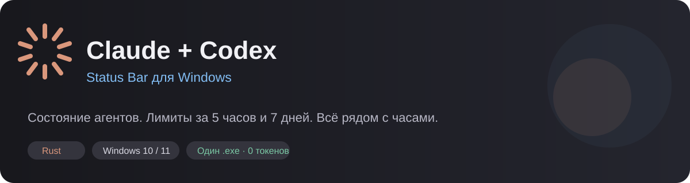
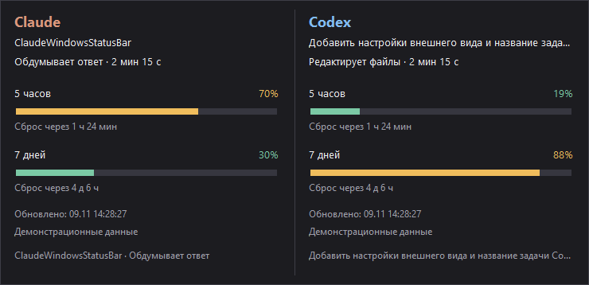
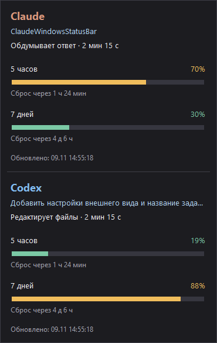

<div align="center">



**English · [Русский](README.ru.md)**

[](https://github.com/danzxz1/claude-status-bar-windows/releases)
[](Cargo.toml)
[](https://github.com/danzxz1/claude-status-bar-windows/actions)
[](LICENSE)

**Two agents. One or two icons. Your usage limits at a glance.**

[Download for Windows](https://github.com/danzxz1/claude-status-bar-windows/releases/latest) · [Features](#features) · [Install](#install) · [Build from source](#build-from-source)

</div>

A small native **Rust** app that monitors **Claude Code and Codex** from the Windows system tray. Hover over its icon to see task titles, activity, elapsed time, and **5-hour / 7-day usage limits**.

**Just download and run the `.exe`.** No Rust compiler, .NET, Node.js, or Visual C++ Redistributable is required to run the app. It does not call models or consume additional tokens.



> Screenshots use demo data. Percentages show quota **used**, not quota remaining. The app currently uses Russian UI labels; instructions below include the actual menu names.

## Features

| | What you get |
|---|---|
| **Claude Code** | Working, tool activity, permission requests, and completed responses |
| **Codex** | Task titles and activity derived from local session events |
| **Usage limits** | Separate 5-hour and 7-day progress bars, percentages, and reset countdowns for each agent |
| **Multiple sessions** | Permission requests take priority over working sessions; up to three rows and a count of the rest |
| **Long titles** | Hover over a task title to read the full displayed title |
| **Appearance** | Spark, Unicode spinner, Clawd crab, and Orbit animations; agent colors or a system-aware monochrome icon |
| **Tracking controls** | Independently enable or disable Claude and Codex; preferences persist across restarts |
| **Notifications** | Completion, permission requests, 80/90/100% thresholds, and resets; optional sound and quiet mode |
| **Panel layout** | Horizontal or vertical, compact mode, 75–150% scale, and individual agent blocks |
| **Windows startup** | Optional startup at sign-in, without administrator rights |

There is no main window or separate taskbar button. Use one combined icon or two independent indicators: orange for Claude and blue for Codex. Each separate icon animates according to its agent's activity. System color mode adapts to the Windows taskbar theme. The app stays in the tray after sessions close so the latest known limits remain available.

## Install

1. Download `ClaudeWindowsStatusBar.exe` from the [latest release](https://github.com/danzxz1/claude-status-bar-windows/releases/latest).
2. Place it in a permanent folder and run it.
3. Find its icon next to the clock. If Windows hides it, expand the tray overflow and drag the icon into the visible area.

### Connect Claude Code

Run this from the folder containing the app:

```powershell
.\ClaudeWindowsStatusBar.exe --install
```

Start a new Claude Code session afterward. The integration adds its command hooks and a `statusLine` wrapper, preserving existing hooks and the output of your original status line. It creates a settings backup before making changes.

When Claude tracking is enabled, a new Claude Code session starts the tray app automatically. Installing the integration does not itself show the panel: run the `.exe` separately or start a new Claude Code session.

### Connect Codex

No additional setup is needed. While Codex tracking is enabled, the running app reads local events from `%USERPROFILE%\.codex\sessions`. A custom `CODEX_HOME` is supported.

**If you only use Codex, start the tray app yourself.** Starting Codex does not launch it. Windows startup is off by default and can be enabled from the tray menu.

## Controls

| Action | Result |
|---|---|
| Hover over the tray icon | Show the panel |
| Left-click the tray icon | Pin or hide the panel |
| Click outside a pinned panel | Unpin it |
| Hover over a task title | Read the full displayed title |
| Right-click → **Appearance** (`Внешний вид`) | Animation, color, timer, text, and separate icons |
| Right-click → **Tracking** (`Отслеживание`) | Enable or disable Claude/Codex data collection |
| Right-click → **Panel** (`Панель`) | Layout, compact mode, scale, and visible agent blocks |
| Right-click → **Notifications** (`Уведомления`) | Events, sound, and quiet mode |
| Right-click → **Windows startup** (`Автозапуск Windows`) | Enable or disable startup at sign-in |
| Right-click → **Exit** (`Выход`) | Quit the app |

The hover panel is suppressed while the context menu is open. A yellow permission indicator remains available with every animation and color mode.

Windows does not provide a standard way to place arbitrary text next to a tray icon as macOS does in its menu bar. Text and timer switches therefore control the panel's activity line; task titles and usage bars remain visible.

## Agent tracking

Right-click → **Tracking** (`Отслеживание`) contains two independent switches: **Track Claude** (`Отслеживать Claude`) and **Track Codex** (`Отслеживать Codex`). Both are enabled by default and persist across restarts.

Disabling an agent stops reading its data, suppresses its notifications, and hides its panel block. Disabling Codex releases the session-log reader. Disabling Claude makes its hook handlers stop saving new states and limits or automatically starting the panel. The hooks remain installed, and your original `statusLine` command still runs.

Existing state files are preserved. When Claude tracking resumes, states older than the enable time are ignored; fresh events populate the panel again. Re-enabling an agent does not replay historical notifications.

The combined color icon reflects agents that are both **installed and enabled for tracking**:

- **Claude only:** orange.
- **Claude + Codex:** orange left half, blue right half.
- **Codex only:** blue.
- **Both disabled:** a gray icon with an accessible menu to enable tracking again.

The **Panel → Show Claude/Codex** settings only control visibility. They do not stop data collection.

## Notifications

Notifications are enabled without sound by default for:

- an agent finishing a response;
- an agent waiting for permission, when that event is available;
- usage first reaching 80, 90, or 100% within a limit window;
- a known limit reset time being reached.

Startup does not generate notifications from old history. Previously reached thresholds do not repeat when percentages fluctuate. Quiet mode suppresses notifications without queuing them for later. A reset countdown means the known window has ended; the next data snapshot confirms the new percentage.

Notifications use Windows' native mechanism. Display and sound also depend on Windows notification and Do Not Disturb settings.

## Panel and icons

The **Panel** (`Панель`) menu offers horizontal and vertical layouts, compact mode without session rows and extra status text, 75/100/125/150% scaling, and separate Claude/Codex block visibility. At least one block stays selected in the visibility settings, but tracking can be disabled completely. The panel shrinks automatically when needed to fit the monitor's work area.


The color boundary stays fixed at the center in all four animations. Installed agents are detected using executable files in `PATH`, standard install locations, and Windows App Paths. Old settings folders or session history do not count as installed applications. Running or stopped sessions do not affect the palette; disabled tracking excludes an agent from it. Installation is checked every 30 seconds. System monochrome mode and the yellow permission indicator remain available.

Task names are plain text with full-title tooltips.

**Appearance → Separate Claude and Codex icons** (`Внешний вид → Отдельные значки Claude и Codex`) enables independent indicators for the visible tracked agents. Hiding a block alone does not disable its notifications. The open panel stays in place when the mouse moves over the tray icon.

<details>
<summary>Compact vertical layout</summary>



</details>

## Windows startup

The startup switch creates or removes only the `ClaudeWindowsStatusBar` value in `HKCU\Software\Microsoft\Windows\CurrentVersion\Run`. Administrator rights are not required. It is disabled by default. If you move the `.exe`, turn startup off and on again to update its path.

## Data sources

**Claude Code:** hook events and the `rate_limits.five_hour` / `rate_limits.seven_day` fields passed to `statusLine`. Percentages update as Claude Code supplies data. Limits may be absent before the first response or without a supported sign-in method.

**Codex:** local JSONL events such as `token_count`, `task_started`, `task_complete`, `turn_aborted`, and tool calls. Task names come from `session_index.jsonl`; when no title is available, a suitable user message is used. Environment instructions are excluded. Limit windows are matched by duration: 300 and 10080 minutes. Other limit buckets are not mixed with the `codex` bucket.

The app **makes no HTTP requests**, reads no `auth.json`, OAuth tokens, or API keys, and adds no messages to model context. Task names are held in memory; message copies are not written to disk.

### Accuracy and limitations

- With no new activity, the panel shows the latest known snapshot and its update time. Reset countdowns run locally. An expired window displays a pending update instead of assuming 0% usage.
- Codex logs do not always report window closure or permission waits. The list contains sessions updated within the last 12 hours. A working session with no events for more than 15 minutes shows “No recent events” (`Нет свежих событий`).
- At startup, the app reads metadata and the last 1 MiB of each of the 16 most recently modified Codex sessions, then processes appended bytes. New files are discovered within 30 seconds. Lines larger than 8 MiB are skipped. If a limit snapshot falls outside the initial tail, wait for the next event containing limits.
- Claude Code project settings may override the user-level `statusLine`. The original command runs in Git Bash with an 8-second timeout; any dependencies of that command are still required. Set `CLAUDE_CODE_GIT_BASH_PATH` for a custom Git Bash location.
- Native `claude.exe` sessions are checked using their PID and process start time. If the process cannot be identified, the app uses SessionEnd and a 24-hour age limit. WSL sessions are not connected in this version.

## Settings and uninstall

Local app data lives in `%LOCALAPPDATA%\ClaudeWindowsStatusBar`:

| File | Purpose |
|---|---|
| `appearance.json` | Tracking, appearance, layout, icons, notifications, and quiet mode |
| `integration.json` | App path and your original `statusLine` |
| `usage.json` | Latest Claude usage snapshot |
| `sessions\*.json` | Claude session states |
| `settings-backup-*.json` | Settings backups created before installation |

Remove the Claude integration with:

```powershell
.\ClaudeWindowsStatusBar.exe --uninstall
```

For complete removal, also disable **Windows startup** and quit the app through its tray menu. Your original status line is restored, and other hooks are preserved. If you manually replaced `statusLine` after installation, uninstall leaves your newer command intact. Do not move the `.exe` after connecting Claude without running `--install` again: hooks use its absolute path.

## Build from source

Development requires Rust and Windows linker tools. Rust MSVC with Visual Studio Build Tools and the Windows SDK is the recommended setup; Rust GNU with MinGW is also supported. **Users of the prebuilt `.exe` do not need these tools.**

```powershell
cargo build --release --locked
cargo test --locked
cargo fmt -- --check
cargo clippy --all-targets --locked -- -D warnings
```

The executable is `target\release\ClaudeWindowsStatusBar.exe`. Static CRT linking is configured in `.cargo/config.toml`.

Alternatively, use `build.ps1`, or `build.ps1 -Install` to build and connect Claude. Quit the running app before replacing its installed `.exe`.

Additional commands:

```powershell
# Show demo data
.\target\release\ClaudeWindowsStatusBar.exe --demo

# Render demo data using the current panel settings
.\target\release\ClaudeWindowsStatusBar.exe --screenshot assets\preview.png

# End-to-end executable checks with temporary settings
.\scripts\smoke-integration.ps1

# Interactive menu checks; quit the regular app first
.\scripts\smoke-ui.ps1
.\scripts\smoke-ui.ps1 -SeparateIcons -Vertical
.\scripts\smoke-ui.ps1 -ToggleTracking
.\scripts\smoke-ui.ps1 -SeparateIcons -DisabledTracking
```

GitHub Actions checks formatting, runs Clippy and tests, and builds the release executable. Pushing a `v*` tag publishes the `.exe`, ZIP, and SHA-256 checksum to GitHub Releases.

## Acknowledgments

The status indicator concept and appearance options were inspired by [m1ckc3s/claude-status-bar](https://github.com/m1ckc3s/claude-status-bar) for macOS. This is a separate native Windows implementation in Rust. It includes no Swift source or graphic assets from the original project; icons are drawn programmatically.

This project is not affiliated with Anthropic or OpenAI. Claude and Codex names belong to their respective owners.

[MIT License](LICENSE)
